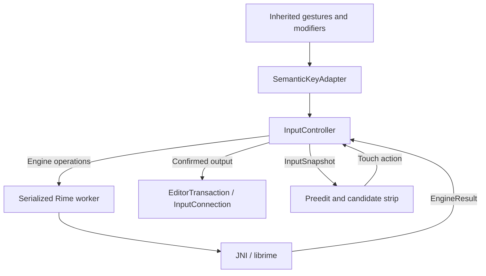

# Architecture

This document records MIANCAK's current high-level architecture direction. It is intentionally more stable than implementation details, but less normative than the interaction contract.

## Goals

MIANCAK should preserve Unexpected Keyboard's mobile interaction strengths while adding Chinese composition with as little runtime machinery as practical.

The architecture should optimize for:

- deterministic touch interaction;
- low input latency;
- offline operation;
- minimal per-key overhead;
- clear separation between literal output and composition-engine input;
- maintainable synchronization with Unexpected Keyboard where practical;
- transparent open-source dependency provenance.

## Runtime shape



## Frontend

The existing Unexpected Keyboard frontend remains the basis of the project, especially:

- key geometry and layout XML;
- touch hit testing;
- swipe-to-direction behavior;
- modifier latch/lock handling;
- rendering and mobile keyboard ergonomics.

The project should avoid rewriting these components without a concrete need.

## Semantic input layer

The semantic input layer is the boundary between touch gestures and text/composition behavior.

It should distinguish actions such as:

- engine key/input;
- literal text;
- candidate selection;
- editing actions;
- language toggle;
- local modifiers.

The core reason for this layer is to avoid treating every visible character as if it had identical behavior.

## Input modes

The initial model should remain small:

```text
CHINESE
ENGLISH
```

Composition state is separate from language mode.

Local modifier state, including Shift latch/lock, is also separate.

Avoid introducing hidden punctuation modes or other context-derived global modes.

## Direct path

Literal text and English direct text should use a fast path to `InputConnection` when no active composition ordering constraint exists.

Examples:

- ordinary English letters in English mode;
- explicit punctuation;
- digits;
- programming symbols.

If a Chinese composition exists, the semantic controller must preserve the ordering rules in `INTERACTION_CONTRACT.md`.

## Composition engine interface

The Android/input layer should depend on a small composition-engine abstraction rather than calling librime directly from UI code.

The first implementation is expected to use librime, but the interface should expose only product-relevant operations such as:

- process engine input;
- inspect composition/preedit;
- read candidate snapshots;
- select a candidate;
- confirm/clear composition;
- set required engine options.

This is an internal abstraction, not a public plugin API.

## Rime threading

Rime calls should run on a serialized, long-lived execution context (`RimeWorker` or equivalent).

The runtime should:

- initialize once per service/runtime lifetime as appropriate;
- keep a long-lived Rime session;
- serialize engine operations;
- avoid session creation/destruction per key;
- avoid filesystem work on the key path.

UI code should consume immutable snapshots/results rather than sharing mutable native state.

## Editor transactions

Operations that must be observed in a strict order should be represented explicitly before applying them to Android's `InputConnection`.

Example:

```text
active composition: 你好
user enters Literal("。")

transaction:
1. commit selected composition
2. commit "。"
3. clear/update composing state
```

Where appropriate, Android batch-edit facilities should be used so the editor observes a coherent update.

## Candidate UI

Chinese candidate presentation should be a dedicated touch-oriented component rather than an accidental extension of the existing English suggestion semantics.

It should consume candidate snapshots from the composition layer and send explicit candidate-selection actions back to the controller.

The candidate UI must not call librime directly.

## Rime data

Rime needs real filesystem paths for shared/user data. Android packaging therefore requires a data-deployment layer.

The intended responsibilities are:

- deploy packaged shared data outside the per-key path;
- track versions/hashes so unchanged files are not recopied unnecessarily;
- keep shared and user data logically separate;
- preserve user-learning data across application upgrades;
- document the provenance and licenses of packaged Rime data.

User-learning data should remain in credential-protected storage unless a later design explicitly justifies Direct Boot access.

## Word lists and extensions

MIANCAK does not plan to provide a general executable plugin system.

Word lists, dictionaries, schemas, and related Rime configuration are treated as data packages. Future import/update formats may be defined, but they must not imply loading arbitrary executable code.

The accepted future dictionary direction is a shared, maintained Rime-compatible `.dict.yaml` source format across languages, with separate schema and version/provenance manifests. Runtime binary formats may differ; any transitional cdict artifacts should be generated from that common source. The converter must preserve traceable upstream inputs and document unsupported metadata rather than silently discarding it.

The cdict word-list conversion/data tooling may later be extracted into an independent project. Sharing source data does not require identical completion/correction algorithms or make a dictionary change an implicit interaction change. Optional suggestions must preserve the direct English/literal path and the current semantic contract.

This is a deferred workstream, not an implemented import interface or new runtime dependency. See [DICTIONARY_ROADMAP.md](DICTIONARY_ROADMAP.md) and [issue #18](https://github.com/AuroraLilja8514/miancak/issues/18) for the phased gates.

## Fcitx5 relationship

MIANCAK may study and reuse architectural ideas from fcitx5-android, especially around Android-native builds and data deployment.

However, the current runtime plan does **not** include Fcitx5 core or `fcitx5-rime` as an intermediate layer.

The intended composition path is directly through librime.

## Performance rules

The architecture should make the following true by construction:

- no disk I/O for ordinary key events;
- no runtime/plugin IPC for ordinary key events;
- direct English/literal input does not require candidate generation;
- Rime sessions are persistent rather than recreated per key;
- candidate rendering only processes the visible/needed data;
- instrumentation can measure touch -> routing -> engine -> candidate/editor latency.

Performance targets should be based on measurements, not guessed millisecond numbers.

## Non-goals for the initial implementation

- general executable plugin compatibility;
- cloud prediction or remote AI services;
- desktop-style candidate-number interaction as the default;
- automatic punctuation guessing;
- Java-to-Kotlin rewrite;
- wholesale replacement of Unexpected Keyboard's gesture system;
- broad architecture for hypothetical future engines before the Rime path works.

## Current implementation boundary

`input/SemanticAction` and `input/InputRouter` provide the first Android-independent routing foundation. The router produces immutable ordered operations; it does not execute engine calls, editor transactions or language-mode changes itself. Its caller must use authoritative composition state after earlier engine work has completed, and apply a resulting mode only after successful execution.

The IME now uses `SemanticKeyAdapter`, `InputController`, `RimeEngine` and immutable `InputSnapshot` values. One serialized worker owns engine operations; UI delivery remains pending until editor transactions apply, preventing direct text from overtaking a completed-but-undelivered commit. Editor generations reject stale work and candidate revisions reject stale taps. Preedit is displayed in the dedicated IME row; only confirmed results enter the application editor. Validation is recorded in [TESTING.md](TESTING.md).
